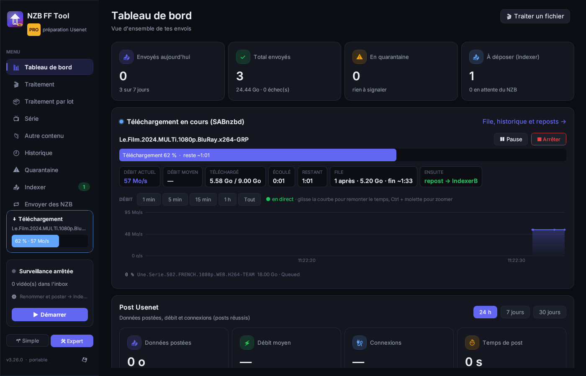
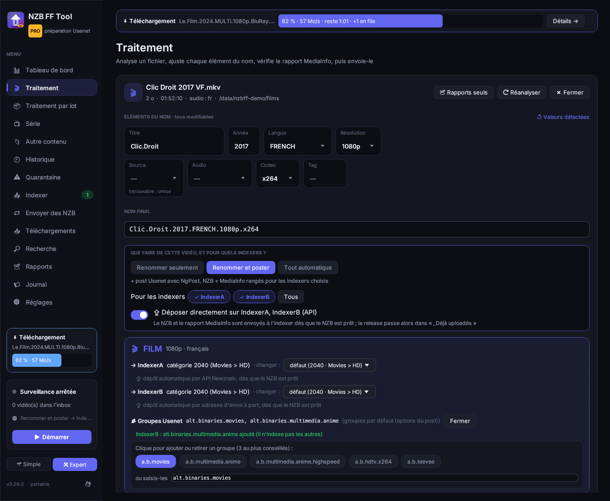
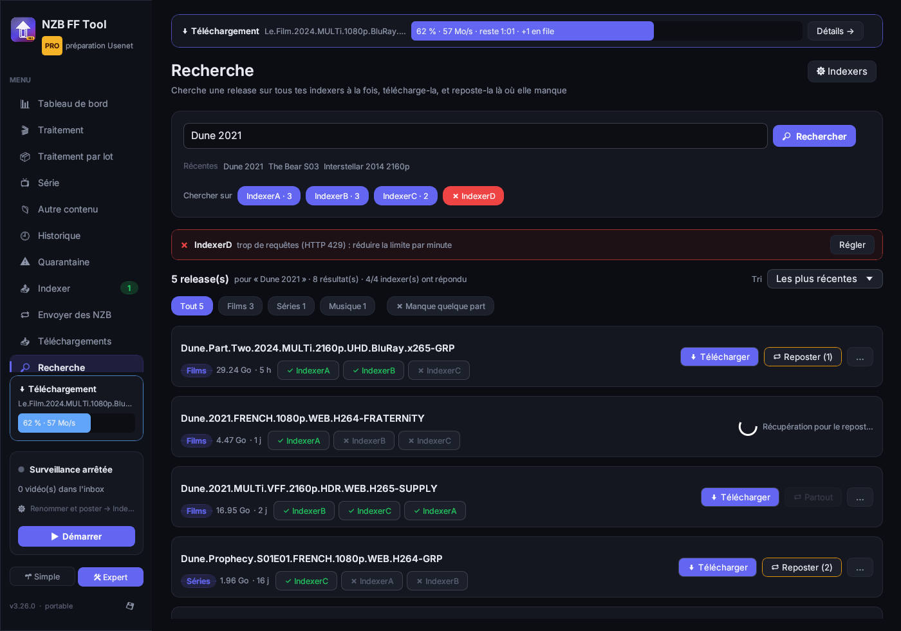
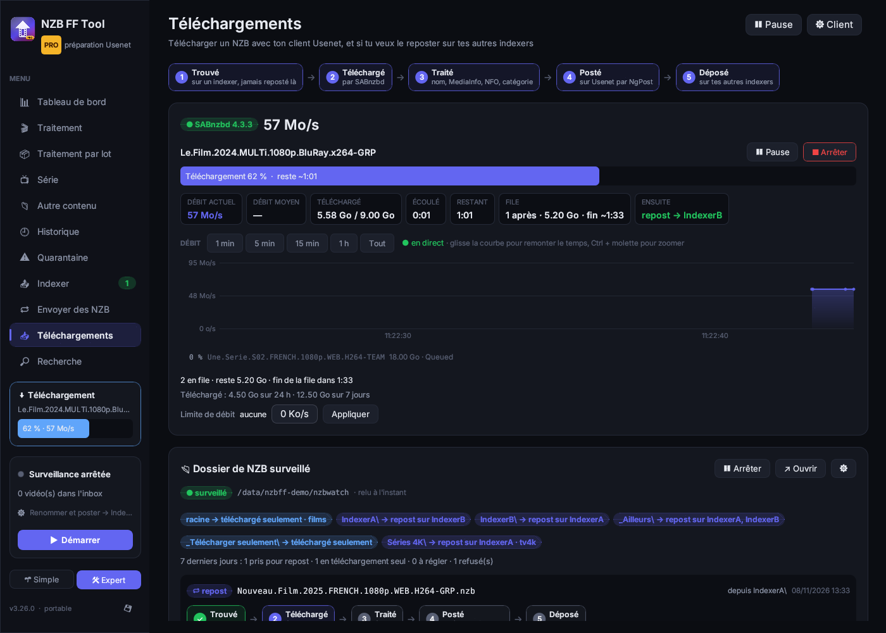
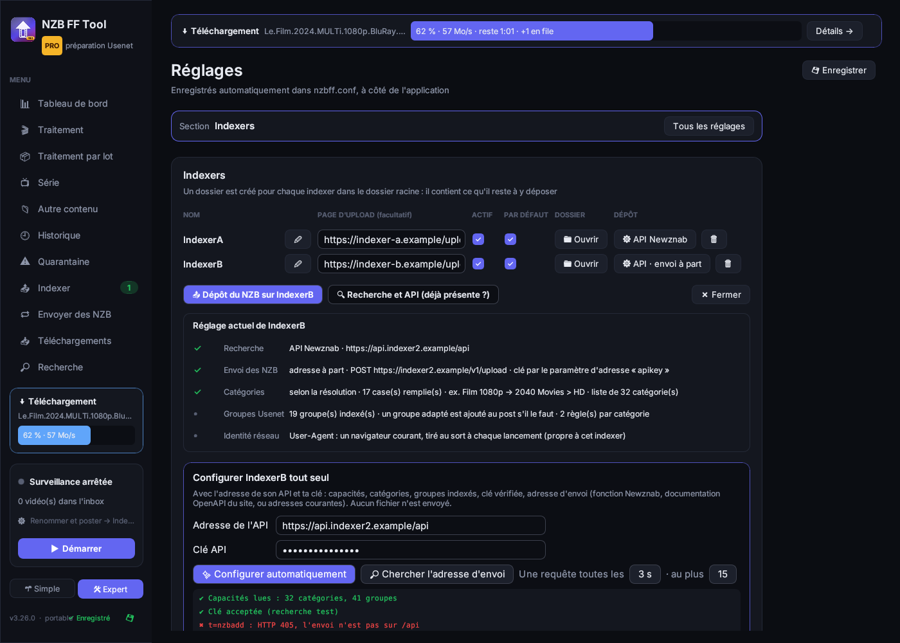
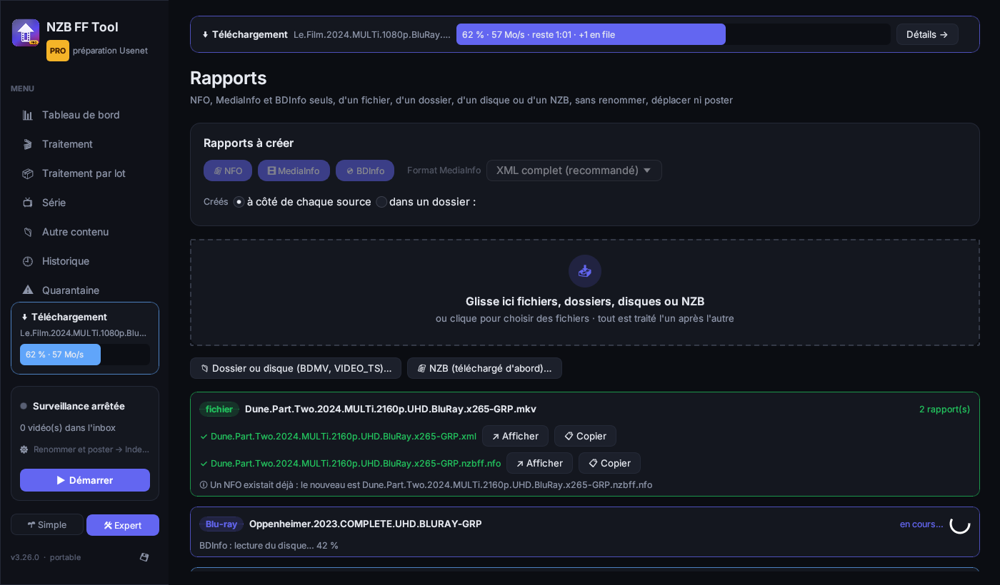
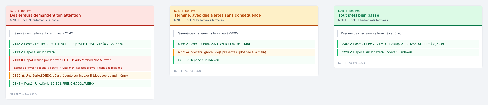

# NZB FF Tool Pro

**Préparer, publier et suivre ses releases Usenet, du fichier de départ au dépôt sur les indexers, dans un seul logiciel Windows.**

Films, séries, disques Blu-ray et DVD, mais aussi jeux, logiciels, musique, ebooks et archives
(ZIP, RAR, 7z, ISO) : NZB FF Tool Pro renomme au format des indexers, crée les rapports
MediaInfo, NFO et BDInfo, poste avec NgPost, dépose sur les indexers par API, vérifie les
doublons, cherche sur tous les indexers à la fois, télécharge et reposte via SABnzbd ou NZBGet.

Simple pour débuter (assistant, mode Simple), complet pour les utilisateurs avancés (mode
Expert, profils d'API, requêtes personnalisées).

Version **3.26.0**. Rust, interface native (egui), un seul `.exe`, **aucune télémétrie**.



---

## Sommaire

- [Aperçu](#aperçu)
- [Fonctionnalités](#fonctionnalités)
- [Confidentialité et sécurité](#confidentialité-et-sécurité)
- [Installation](#installation)
- [Premiers pas](#premiers-pas)
- [Organisation du code](#organisation-du-code)
- [Tests](#tests)
- [Historique](#historique)
- [Soutenir le projet](#soutenir-le-projet)
- [Licence](#licence)

---

## Aperçu

**Traitement** : nom final, indexers visés, catégorie de chacun, groupes Usenet du post.



**Recherche sur tous les indexers** : chaque release montre où elle est et où elle manque.



**Téléchargements et repost** avec SABnzbd ou NZBGet.



**Indexers** : configuration automatique et résumé de ce qui est réglé.



**Rapports seuls** : NFO, MediaInfo et BDInfo sans rien renommer ni poster.



**E-mails de notification en couleur** : rouge en cas d'erreur, jaune pour de simples alertes, vert quand tout va bien.



---

## Fonctionnalités

### Tout type de contenu

- **Vidéos** : film seul, dossier de film, plusieurs vidéos d'un coup (traitement par lot).
- **Séries** : saisons et épisodes détectés, saison entière traitée d'un coup, nommage
  cohérent de chaque épisode.
- **Disques complets** Blu-ray et DVD (dossiers BDMV / VIDEO_TS, images ISO), avec BDInfo.
- **Autres contenus** : jeux PC et consoles, logiciels, musique, ebooks, BD, archives ZIP,
  RAR et 7z, chacun avec sa catégorie.
- **Glisser-déposer** ou sélection de fichiers, archives visibles d'emblée.

### Nommage et traitement

- **Nom au format des indexers**, calculé d'après MediaInfo : titre, année, langue (FRENCH,
  MULTi, VFF, VOSTFR…), résolution, source, codecs, HDR, équipe. Chaque élément reste modifiable.
- **Trois niveaux d'action** : renommer seulement, renommer et poster, ou tout automatique
  (post puis dépôt sur les indexers choisis).
- **Indexers visés juste sous le nom**, avec la catégorie de chacun et son nom chez l'indexer
  (« défaut (2040 · Movies > HD) »).
- **Groupes Usenet du post** au choix : propositions selon le contenu, les réglages et les
  groupes réellement indexés par chaque indexer, ou saisie libre.
- **Récapitulatif avant de lancer** : nom, destination, rapports, indexers, catégories, groupes,
  doublons, place sur le disque. Chaque problème est expliqué avec sa correction en un clic.

### Rapports : MediaInfo, NFO, BDInfo

- MediaInfo complet (XML, texte, JSON ou HTML), NFO lisible, BDInfo pour les Blu-ray.
- **Page « Rapports »** : rapports seuls de fichiers, dossiers, disques ou NZB (téléchargés
  d'abord), en file, à côté de la source ou dans un dossier choisi. Un NFO existant n'est
  jamais écrasé.
- **Jamais de dépôt sans MediaInfo** : contrôle avant chaque envoi.

### Post Usenet avec NgPost

- Serveurs, connexions, taille d'articles, obfuscation, fichiers de réparation (par2 de NgPost,
  par2cmdline-turbo ou ParPar).
- **Groupes Usenet** par type de contenu, par catégorie d'indexer, ou ajoutés automatiquement
  quand l'indexer l'exige.
- **Suivi en direct** : progression, débit, courbe de vitesse, temps restant, arrêt propre.
- File d'attente des posts et reprise après coupure.

### Indexers

- **Dépôt direct par API** : Newznab (`t=nzbadd`), adresse d'envoi à part (ex. `/v1/upload`,
  la recherche restant sur l'API Newznab), commande personnalisée, ou dépôt à la main.
- **Configuration automatique** avec l'adresse de l'API et la clé : capacités, catégories,
  groupes, vérification de la clé, adresse d'envoi. Délai réglable entre deux requêtes et
  nombre maximum de requêtes, pour ne jamais se faire bannir. Annulable.
- **Lecture de la documentation d'API** de l'indexer (texte collé ou fichier), puis application
  des réglages en un clic.
- **Réglage actuel** de chaque indexer : recherche, envoi, catégories, groupes, identité réseau,
  en vert quand c'est prêt.
- **Dépôt refusé** : diagnostic et correction proposée (405, 404, 401/403, 413, 422, 429, codes
  Newznab…).
- **Aperçu exact de chaque requête** avant l'envoi, clé masquée, puis la réponse reçue.
- **Catégories** : import de la liste de l'indexer, remplissage automatique (films et séries
  SD / 720p / 1080p / UHD, versions FR, autres contenus), export texte, CSV ou JSON.
- **Profils d'API** : préréglages, explorateur de requêtes, lecture des réponses XML, JSON ou
  HTML, import et export.
- **Ma requête** : écrire sa propre requête (adresse, « POST … » ou commande curl de la doc), la
  tester et la garder.
- **User-Agent** au choix : curl, NZB FF Tool Pro, navigateur courant tiré au sort, roulement à
  chaque requête, ou texte personnalisé.

### Doublons

- Avant chaque post, la release est cherchée sur chaque indexer visé, **sous son nom renommé et
  sous ses noms d'origine** (fichier, dossier, NZB reçu).
- **« Uploadée à la main sur X »** : la release n'y est plus jamais repostée.
- Au choix : ne pas poster pour cet indexer, avertir, ou ignorer.

### Recherche sur tous les indexers

- Une recherche part sur tous les indexers à la fois, chacun avec sa limite de requêtes.
- Résultats **regroupés par release** : où elle est, où elle manque, taille, âge, type.
- Filtres Films, Séries, Musique, Livres, Autre, et « manque quelque part ».
- **Télécharger**, **reposter seulement là où elle manque**, rapports seuls, enregistrer le NZB.

### Téléchargements et repost

- SABnzbd et NZBGet : envoi d'un NZB ou d'une adresse, suivi des files, pause et reprise.
- Modes : téléchargement seul, repost vers d'autres indexers (traitement complet), rapports seuls.
- **Dossiers de NZB surveillés**, entièrement réglables.

### Automatisation

- **Inbox surveillée** : chaque fichier déposé suit le circuit choisi sans rien demander.
- Démarrage avec Windows, application dans la zone de notification.
- Intégration à l'Explorateur : clic droit, ouverture des `.nzb`.
- **Mode sans interface** (ligne de commande) pour les scripts.

### Notifications et suivi

- **E-mail de notification en couleur**, texte brut joint.
- Historique, statistiques, journaux détaillés, quarantaine des fichiers douteux.

### Confort

- **Interface Simple ou Expert**, assistant au premier lancement.
- Thème clair ou sombre, couleur d'accent, recherche dans les réglages.
- Sauvegarde automatique et restauration des réglages.
- Presque rien au repos : fenêtre cachée ou réduite, aucune image n'est dessinée.

---

## Confidentialité et sécurité

- **Aucune télémétrie, aucune statistique d'usage envoyée.** L'application ne contacte que ce
  que tu configures : tes indexers, ton client de téléchargement, tes serveurs Usenet et ton
  serveur d'e-mail.
- **Clés API et mots de passe jamais écrits dans les journaux ni sur une ligne de commande** :
  curl les reçoit par un fichier de configuration temporaire (`-K`), et ils sont masqués dans
  tous les affichages.
- Les réglages restent sur ton PC, à côté de l'application (dossier `dist\`), jamais dans ce
  dépôt.

---

## Installation

### Télécharger l'application

La version compilée est dans les [Releases](../../releases) : télécharge
`NZB FF Tool Pro.exe` et lance-le. Rien à installer.

### Compiler soi-même

Windows 10 ou 11, sans IDE.

1. **Rust**, chaîne GNU (par exemple avec Chocolatey) :
   ```
   choco install rustup.install -y
   rustup default stable-x86_64-pc-windows-gnu
   ```
2. **MinGW-w64** (WinLibs, version UCRT, [winlibs.com](https://winlibs.com)) décompressé dans
   `C:\mingw64`.
3. Double-clic sur **`build.cmd`** : l'application est créée dans
   **`dist\NZB FF Tool Pro.exe`**.

Outils externes utilisés s'ils sont présents (chemins réglables) : MediaInfo, NgPost,
par2cmdline-turbo ou ParPar, BDInfo, curl (inclus dans Windows 10 et 11).

---

## Premiers pas

1. Au premier lancement, l'**assistant** demande l'essentiel : dossiers, NgPost, indexers.
2. Pour chaque indexer : **Réglages → Indexers → l'indexer → « Configurer automatiquement »**,
   avec l'adresse de l'API et la clé.
3. Glisse un fichier sur la page **Traitement**, vérifie le nom et les indexers, lance.

---

## Organisation du code

| Fichier | Rôle |
|---|---|
| `src/main.rs` | démarrage, mode sans interface |
| `src/gui.rs` | interface (pages, réglages, fenêtres) |
| `src/prep.rs` | réglages, nommage, MediaInfo, NFO |
| `src/jobs.rs` | traitements, inbox surveillée, rapports seuls |
| `src/ngpost.rs` | post avec NgPost, groupes Usenet, circuit vers les indexers |
| `src/upload.rs` | dépôt sur les indexers, catégories, appels curl sécurisés |
| `src/apidef.rs` | profils d'API, requêtes, lecture des réponses, User-Agent |
| `src/apidoc.rs` | lecture des docs d'API, configuration automatique, diagnostic |
| `src/search.rs` | vérification des doublons, « uploadée à la main » |
| `src/finder.rs` | recherche sur tous les indexers |
| `src/dl.rs` | SABnzbd et NZBGet, NZB surveillés, repost |
| `src/disc.rs` | Blu-ray, DVD, BDInfo |
| `src/series.rs`, `src/content.rs` | séries, autres contenus |
| `src/notify.rs` | e-mails de notification |
| `src/backup.rs` | sauvegarde et restauration des réglages |
| `src/tray.rs` | zone de notification, démarrage avec Windows |

---

## Tests

```
cargo test
```

Environ 170 tests automatiques : nommage, séries, MediaInfo, catégories, dépôts, configuration
automatique contre un faux indexer, recherche, groupes, e-mail, sauvegarde… Deux tests de
lecture de documentation d'API utilisent des fichiers d'exemple non publiés : sans eux, ils
sont simplement sautés.

---

## Historique

Le logiciel a été développé en privé jusqu'à la version 3.26.0, première version publiée ici.
Le détail de chaque version et le mode d'emploi complet, réglage par réglage, sont dans
**[LISEZMOI.md](LISEZMOI.md)**.

---

## Soutenir le projet

NZB FF Tool Pro est gratuit et open source. S'il te rend service, un don aide à le maintenir à
jour (les API des indexers changent souvent) :

- **Monero (XMR)** : 87mbgGKqNXccHrDasneNmkfKYsPwJu16xfoR4YbzpFo9fQmY4xDxePH4CbPX2Ja8PN7Ld3BjmLtFAB18Y4qfqakiNw4BKi2

Merci !

---

## Licence

Copyright (C) 2026 florent4040

Ce programme est un logiciel libre : tu peux le redistribuer et le modifier selon les termes de
la **GNU General Public License version 3** (ou toute version ultérieure), publiée par la Free
Software Foundation. Toute version modifiée et redistribuée doit rester sous la même licence,
avec son code source.

Ce programme est distribué dans l'espoir qu'il sera utile, mais **sans aucune garantie**. Voir
le fichier [LICENSE](LICENSE) pour les détails.
